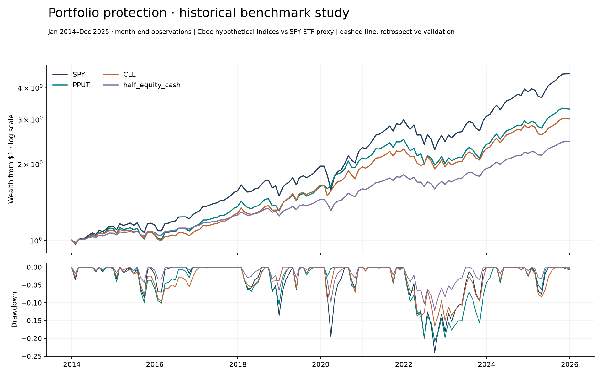

# Options-Based Portfolio Protection Lab

**What does downside protection cost—and does it outperform simply holding less equity?**

A reproducible research package combining a continuous **2014–2025 historical benchmark study**, a complete **daily 2021–2025 comparison**, and funded option-model experiments. Two executed Jupyter notebooks connect the evidence to the code.

In daily retrospective validation, the put-protection index earned **9.31% CAGR with −22.14% maximum drawdown**, versus **14.38% and −24.50%** for SPY. The collar index earned **9.12% with −17.23% drawdown**. A monthly 50/50 equity/cash control earned **9.03% with −12.44% drawdown**. Protection reduced downside versus SPY, but the cash alternative makes the trade-off harder to justify on drawdown alone. [Results, definitions and limitations →](results/historical/RESEARCH_MEMO.md)



| Explore | What it establishes |
|---|---|
| [Historical research notebook](notebooks/01_historical_evidence.ipynb) | Return, downside, cash controls, source audit and uncertainty |
| [Hedge experiment notebook](notebooks/02_hedge_experiments.ipynb) | Funded puts/collars, premium budgets and independent model experiments |
| [Historical memo](results/historical/RESEARCH_MEMO.md) | Methods, continuous benchmark findings and failure analysis |
| [Model robustness](results/robustness/README.md) | 24 regime comparisons and 288 rolling sensitivities; no retuning |
| [Verification record](docs/VALIDATION.md) | What was run and what remains outside the evidence |

## Run locally

Python 3.10 or newer; the published verification used Python 3.12. Both notebooks run offline by default. Python 3.12 is recommended for the optional pinned numerical environment.

```bash
git clone https://github.com/ambekarhrush/options-hedging-research.git
cd options-hedging-research
python -m venv .venv
source .venv/bin/activate
# Windows PowerShell: .venv\Scripts\Activate.ps1
pip install ".[notebooks]"
python -m unittest discover -s tests -v
python scripts/verify_results.py
jupyter lab notebooks/
```

For the numerical package versions used in the published run, use `pip install -c requirements-research.txt ".[notebooks]"` on Python 3.12. The original vendor bytes are identified by hashes, not redistributed; package pinning cannot prevent vendor revisions.

Execute every notebook from a fresh kernel and export local HTML previews:

```bash
python scripts/check_notebooks.py
```

## Reproduce the research

```bash
# Synthetic scenario accounting and budget selection; no downloads
python -m hedgelab.study

# Frozen-choice stresses and all rolling sensitivities; no downloads
python -m hedgelab.robustness

# Cboe benchmarks, SPY adjusted prices, and French cash proxy; downloads on first run
python -m hedgelab.historical
```

Results are written to `results/`; raw provider files remain in ignored `data/private/`. The historical command reuses cached bytes. To study revised provider files without overwriting the published evidence, use `python -m hedgelab.historical --cache data/private/new-run --out outputs/new-history`.

## Three distinct kinds of evidence

**Historical benchmark research.** Cboe PPUT and CLL are hypothetical total-return indices, not investor fills. SPY is an ETF proxy and includes fund expenses. The longer comparison uses verified exchange month-ends; all 1,255 daily returns in 2021–2025 are present. Missing earlier daily observations are disclosed in the [source audit](results/historical/provenance.json). Monthly drawdowns miss intramonth losses. The 2021 split is retrospective, not an untouched holdout.

**Funded model overlays.** European, cash-settled puts and covered collars on four synthetic paths, with explicit cash, option marks, strikes, expiry dates and fees. Independent tests reconcile every NAV and expiry settlement. The model collar rolls both legs together and does not replicate CLL’s quarterly puts and monthly calls.

**Static hedge sizing.** A 2% upfront premium budget, terminal ES95 objective, frozen training selection and independently seeded validation. Stress experiments vary volatility, drift, IV and crash frequency. Budget breaches are flagged, all candidate diagnostics are disclosed, and the selected hedge is never retuned to a stress regime. The original model memo is [here](results/RESEARCH_MEMO.md).

## Research boundaries

This release completes the public-data benchmark and model research scope. It does **not** claim a historical option-chain execution backtest. Such a study needs licensed point-in-time quotes, contract expiries, bid/ask execution, rates, dividends and settlement conventions. Synthetic scenarios are not reconstructions of 2008, 2020 or 2022. The original three published crisis-quarter comparisons remain contextual evidence; they do not establish continuous performance.

Index-level histories cannot identify realised premium spend or trade-level costs. The annual-drag sensitivity is an explicit approximation. No future-alpha or universally optimal hedge claim is made.

## Project map

| Path | Purpose |
|---|---|
| `hedgelab/historical.py` | Source validation, calendar audit, cash controls, historical analysis and report |
| `hedgelab/options.py` | European pricing, funded overlay ledger and static sizing |
| `hedgelab/robustness.py` | Frozen-choice regime stresses and rolling sensitivities |
| `hedgelab/study.py` | Original synthetic experiments and selected-quarter context |
| `tests/` | Financial accounting, pricing, timing, leakage and data-validation checks |
| `notebooks/` | Executed, editable research walkthroughs |
| `results/` | Reviewable aggregate evidence, model ledgers, figures and provenance |

The historical memo links primary sources and methodology documents. Raw vendor archives, credentials and local environments are excluded from Git.
