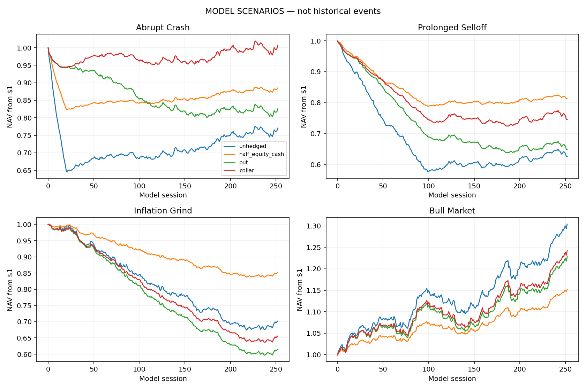

# Options-Based Portfolio Protection Lab

How much downside protection does an option premium buy, and how much upside does a collar surrender? This research project compares protective puts, collars and reduced equity exposure. It combines published historical Cboe benchmark quarter results with a separate, explicitly synthetic option-model engine.

**Start with [the research memo](results/RESEARCH_MEMO.md).** The historical figures are published benchmark-index results for three selected quarters. Custom strategy simulation and hedge sizing are models, not empirical historical option backtests.



Under the stated synthetic model, the selected hedge uses an 85% strike and 75% coverage, spending 1.99% of NAV upfront. In an independently seeded model sample, terminal ES95 is 21.73% versus 35.57% unhedged, with lower mean return. These are model sensitivities, not market performance. See the [validation output](results/independent_model_validation.json).

## Reproduce

Python 3.10 or newer.

```bash
git clone https://github.com/ambekarhrush/options-hedging-research.git
cd options-hedging-research
python -m venv .venv
source .venv/bin/activate
pip install .
python -m unittest discover -s tests -v
python -m hedgelab.study
```

Outputs include published quarter comparisons, synthetic scenario NAV and ledgers, full candidate sizing grid, independently seeded model validation, chart and research memo. Model paths use seed 42; sizing training 142; validation 314. No API key, data subscription or LLM required.

## Research map

- `hedgelab/options.py` — European option valuation, funded option overlay ledger, scenario generator and static premium-budget sizing.
- `hedgelab/engine.py` — drawdown and return calculations.
- `hedgelab/study.py` — quarter comparison, model study and independent model validation.
- `tests/` — valuation, timing, funding and budget checks.
- `results/` — generated evidence and memo.

The historical comparison covers published Q4 2008, Q1 2020 and Q2 2022 benchmark returns; it does **not** implement a historical option-chain backtest. See the memo for essential limitations and the empirical next step.
