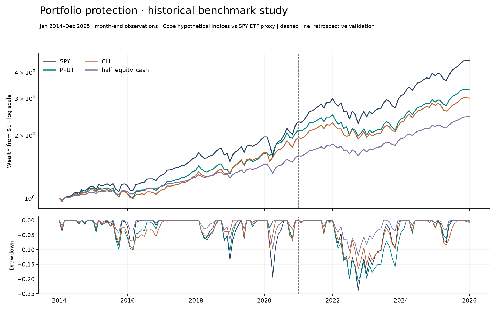

# Options-Based Portfolio Protection

*Historical benchmarks plus synthetic option models · Prepared 5 November 2026*

## The research question

Does buying downside protection justify its cost when simply holding less equity is available?

## Approach

A 2014-2025 benchmark study is paired with a complete daily 2021-2025 comparison and funded model ledgers. Puts and collars are evaluated against SPY and explicit equity/cash controls; frozen model selections face independent stress experiments.

## Evidence and result

The retrospective daily comparison reports put protection at 9.31% CAGR / -22.14% drawdown and collars at 9.12% / -17.23%, versus SPY at 14.38% / -24.50%. A 50/50 cash control reaches 9.03% / -12.44%, making the opportunity-cost comparison central.

*Retrospective benchmark study; see historical memo for definitions.*

## Scope and limitations

Cboe benchmarks are hypothetical indices, not fills. Earlier daily coverage is incomplete; monthly drawdowns miss intramonth losses. The 2021 split is retrospective. Synthetic option paths and static premium sizing do not reconstruct historical option-chain execution.

## Explore the project

Open the two executed notebooks and historical memo. Run python scripts/verify_results.py and python -m unittest discover -s tests -v; notebook defaults are offline.

## Sources and evidence

[results/historical/RESEARCH_MEMO.md](../results/historical/RESEARCH_MEMO.md) · [docs/VALIDATION.md](../docs/VALIDATION.md) · [results/historical/summary.csv](../results/historical/summary.csv)

---

Hrush Ambekar · Research snapshot reviewed 5 November 2026. See linked source files for full methodology, figures and reproducibility.
